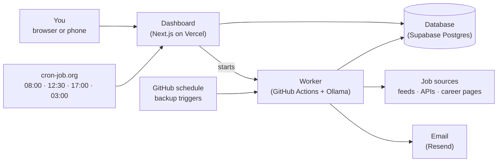

# Surelane: System Overview

A plain-words tour of the whole project: what it is, who it's for, and how a vacancy travels from a job site to your inbox.

---

## What it is

Looking for work in Sri Lanka means checking a dozen sites every day, re-typing the same searches, and finding out too late that a job closed last week.

**Surelane** is a personal job-search agent that does that work for you:

- 📄 **Upload your CV once.** It reads your roles, skills and experience, and keeps the CV encrypted.
- ⏰ **Searches three times a day**, at 8:00 AM, 12:30 PM and 5:00 PM Sri Lanka time, even when your computer is off.
- ✅ **Only open jobs.** It checks every vacancy is still live before recommending it.
- 🎯 **Ranked for you.** Each job gets a match score against your CV, with the skills you share and the ones you're missing.
- 📬 **Emails you the new ones**, with Local (Sri Lanka) and Global (abroad and remote) in separate sections.
- ✍️ **Cover letters and tracking.** Tailor your own letter to any job, and follow each application from Saved to Offer.
- 🔒 **Respectful by design.** It only reads sites that allow it, and says plainly which ones it can't.
- 💸 **Free to run** on free plans, with free open-source AI.

## Who uses it

| Who | What they do |
|---|---|
| **You (the owner)** | The one account. Upload a CV, set preferences, read matches, track applications |
| **The agent** | Runs on its own at each search time: searches, checks, scores, emails, cleans up |

There's no public sign-up. The first account closes registration, and it needs a private setup code.

---

## A job seeker's day

1. **Set up once.** Upload a CV (PDF, DOCX or text). Surelane builds a profile: target roles, top skills, experience level. Choose Local, Global or both, and your search times.
2. **8:00 AM.** The agent wakes, searches every permitted source, drops closed and old jobs, scores the rest, and emails the new matches.
3. **Open Today.** The next search, anything that **needs you**, your best matches and your numbers.
4. **Look closer.** On a job: the match ring, shared and missing skills, an AI second opinion, and a summary.
5. **Search further.** For sites Surelane can't read (LinkedIn, Indeed, TopJobs.lk and others), the **Jobs** page offers ready-made searches built from your CV. Found something? **Add a job you found** and it's scored like the rest.
6. **Apply.** Save the job, **tailor your cover letter**, and move it along in Applications.
7. **12:30 PM and 5:00 PM.** The same again. No job is ever emailed twice.
8. **3:00 AM.** Cleanup removes job data older than 30 days. Your CV, settings and applications are never touched.

An application moves through these stages:

```
Saved → Interested → Applied → Interview → Shortlisted → Offer Received
          (Rejected can end it at any stage)
```

A match is scored out of 100: **Strong** (75+), **Good** (60+) or **Potential** (45+). Below that it isn't shown as a match.

---

## How it fits together



- **Dashboard (Next.js on Vercel):** the pages you use, sign-in, CV upload and the small API behind them. It holds no search logic.
- **Database (Supabase):** your account, encrypted CV and cover letter, settings, jobs, applications and search history.
- **Timer (cron-job.org):** wakes the dashboard at each slot, which starts the worker. GitHub's own schedule fires three backup triggers per slot in case one is late.
- **Worker (GitHub Actions):** does the real work. It reads the sources, checks, scores, runs the local AI and sends the email. A slot can only run once a day, however many triggers arrive.
- **Email (Resend):** the job alerts and the test email.

### Where the jobs come from

| Kind | Sources |
|---|---|
| **Local** (Sri Lanka) | ITPro.lk, Jobpal.lk, Govjobs.lk and Govdoc Jobs (government vacancies, marked **Government**) |
| **Global** (abroad, remote) | Jobicy, Remotive, Remote OK |
| **Both**, filtered by your switches | Himalayas, Jooble, up to 100 company career pages, and RSS feeds you add |
| **Not read, but searchable by you** | LinkedIn, Indeed, Glassdoor, TopJobs.lk, ikman Jobs, XpressJobs and others. Each forbids automated reading or has no permitted feed |

**Career pages** are read in the most reliable way available: first a hiring system (Lever, Greenhouse, Ashby, SmartRecruiters, Workable, Recruitee), then structured job data on the page, then plain job links. If robots.txt says no, or the page needs a sign-in, it's marked **Not allowed** and left alone.

### Where the AI fits

| Engine | Cost | What it's like |
|---|---|---|
| **Built-in engine** (default) | Free | Rules only. Plain, instant, private. The app works fully on it |
| **Local AI: Ollama + Qwen 3 1.7B** (recommended) | Free, open source (Apache 2.0) | Runs inside GitHub's runner. A second opinion on top matches, better cover letters and summaries. Nothing leaves your own runner and database |
| **Gemini** (optional) | Free tier | Cloud, not open source. Your name, email, phone and links are removed before sending |

The AI is a helper, not the judge. Its score counts for half of a job's score, the facts in your profile always come from your CV, and if the model can't start the search still runs on the built-in engine.

### Why you can trust the results

- **Only live vacancies.** A job is recommended only if its deadline hasn't passed, it isn't marked closed, it's within your age limit (30 days by default), and its source confirmed it in the last 3 days.
- **No job twice.** Each job is emailed once. If an email fails, its jobs wait for the next one and **Needs you** says so.
- **Honest about sources.** A skipped or failed source is shown with its reason, and never reported as checked.
- **Your CV stays private.** It's encrypted (AES-256-GCM) in the database. Emails carry matches and skill notes, never your CV.
- **Locked down.** One owner, hashed password, sign-in lockout after five wrong tries, strict security headers, and no caching of private pages.
- **Tidy by default.** Job data is kept for a rolling 30 days, then deleted. Your CV, settings and applications stay until you remove them.
- **Tested.** Scoring, sources, schedules, cleanup, email, cover letters and security each have their own tests against a real Postgres.

---

## Look and feel

The brand is called **"Obsidian Iris"**. The mark, **"Lane"**, is three bands that grow toward you, like markings on the road ahead, one for each daily search.

| Colour | Used for |
|---|---|
| Near-black `#0E0C1C` | The hero band, app icons, the sign-in screen |
| Iris `#4F3BD6` (light) / `#9D8CFF` (dark) | The brand and main actions |
| Soft violet `#8F7BFF` · Lilac `#CFC8FF` | Accents and the top band of the mark |
| Emerald | Safe: on, searched, still open |
| Amber | Look at this |
| Rose | Stop |

**Fonts:** Schibsted Grotesk (wordmark and headings) and Inter (everything else), both self-hosted under the SIL Open Font License.

Content sits on soft cards with 16px corners. The signature pieces are the **match ring** (score plus tier), the **day timeline** on Today, and the **stage cards** in Applications. Desktop gets a sidebar. Phones get a frosted top bar and a five-tab bottom bar, and Surelane can be added to the home screen like an app. Light, dark or match your device. Every colour pair meets WCAG AA, and colour never works alone: each state also has a word or an icon.

**Plain words throughout:** sentence case, no jargon, and no promise the app can't keep. Surelane checks that a listing is live, not that an employer is honest, and it says so.

---

## Built with

Next.js 16 · React 19 · TypeScript · Tailwind CSS v4 · Postgres (Supabase) · node-postgres · Zod · Cheerio · unpdf · Mammoth · Ollama (Qwen 3 1.7B) · Resend · GitHub Actions · cron-job.org · Vitest · Vercel

## Where to find things

| Part | Folder |
|---|---|
| Dashboard pages | `src/app/(app)/` |
| Sign-in and setup | `src/app/login/`, `src/app/setup/` |
| API | `src/app/api/` |
| Shared components and logo | `src/components/` |
| Job sources | `src/lib/sources/` |
| Scoring | `src/lib/match/` |
| CV reading | `src/lib/cv/` |
| AI | `src/lib/ai/` |
| Search run and worker | `src/lib/search/`, `src/worker/` |
| Email | `src/lib/notify/` |
| Database tables | `db/schema.sql` |
| Scheduled runs | `.github/workflows/` |
| Tests | `tests/` |

Setup, settings and going live are in the **[README](README.md)**.

---

## Good to know

- **Coverage depends on your field.** ITPro.lk is IT-focused, Jobpal.lk covers every field but posts a few jobs a day, and the global sources are mostly remote roles. Outside IT, lean on the site searches in **Jobs**, Jooble and career pages.
- **No check is perfect.** A site can leave a filled job up, so a confirmed job could still be gone when you apply.
- **Always read a cover letter before sending it**, AI or not.
- **Surelane is a working name.** It hasn't had a trademark search.
- The source checks were made in **November 2026**. Sites change their terms, so recheck before any commercial use.
- **Built by Softro Code Labs**, November 2026.
